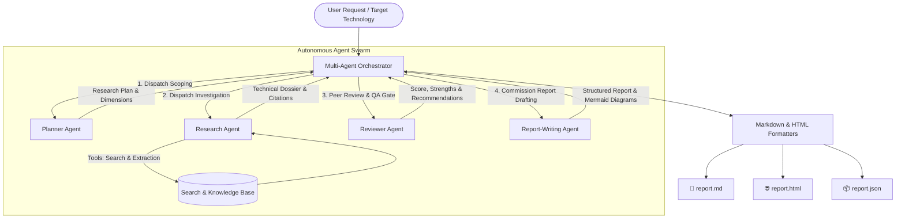

# Multi-Agent Technical Report Generation System 🚀

An autonomous multi-agent architecture featuring specialized agents that collaboratively research complex technologies, conduct peer-audited evaluations, and synthesize publication-grade structured technical reports.

---

## 🏛 Architecture & Agent Swarm

The system is organized around four specialized autonomous agents coordinated by a central orchestrator:



### Specialized Agents

| Agent | Role | Responsibilities |
| :--- | :--- | :--- |
| **Planner Agent** | Technical Strategist & Scoper | Decomposes target technology into core dimensions: Internals & Execution Model, Performance & Latency Benchmarks, Ecosystem & Tooling, and Operational Trade-offs & Anti-Patterns. |
| **Research Agent** | Deep Investigator & Evidence Gatherer | Executes targeted technical queries across web/documentation sources, gathers empirical benchmarks, extracts idiomatic code patterns, and verifies citations. |
| **Reviewer Agent** | Peer Auditor & Fact-Checker | Critically evaluates research findings against principal engineering standards, checks technical depth, scores rigor (0-100), and provides actionable recommendations. |
| **Report-Writing Agent** | Lead Technical Author | Synthesizes verified research and auditor feedback into an exhaustive, publication-grade technical report with Mermaid architecture diagrams, benchmark matrices, comparative tables, and code snippets. |

---

## ⚡ Key Highlights

- **Zero Mandatory External Dependencies:** Built with pure Python standard library capabilities; works immediately out-of-the-box without requiring complex compilation or heavy frameworks.
- **Pluggable LLM Backends:**
  - **Google Gemini** (Gemini 2.5 Flash / Gemini 2.5 Pro) via direct HTTP REST or official SDK.
  - **OpenAI** (GPT-4o) and OpenAI-compatible endpoints (Ollama, Groq, vLLM, LocalAI).
  - **Intelligent Deterministic Mock Engine** for zero-API-key instant testing, CI/CD, and offline demonstration.
- **Multi-Format Publication Artifacts:**
  - `report.md`: GitHub-Flavored Markdown with automatic Table of Contents, code blocks, and comparison tables.
  - `report.html`: Self-contained, responsive HTML report featuring Dark/Light theme, live Mermaid.js diagram rendering, and print/PDF optimization.
  - `report.json`: Full structured schema containing parsed sections, citations, and metadata for downstream systems.
- **Dual Interfaces:**
  - **Interactive CLI:** Real-time color-coded agent telemetry and streaming deliberation.
  - **Web Studio Dashboard:** Modern UI for triggering research, observing agent deliberations in real-time, and reviewing/downloading reports.

---

## 📦 Installation & Setup

1. **Navigate to the project directory:**
   ```bash
   cd /Users/devanshibute/.gemini/antigravity/scratch/multi-agent-tech-reporter
   ```

2. **(Optional) Configure API Keys in `.env`:**
   Copy `.env.example` to `.env`:
   ```bash
   cp .env.example .env
   ```
   Configure your preferred provider:
   ```env
   # LLM Provider: 'auto', 'gemini', 'openai', or 'mock'
   LLM_PROVIDER=auto

   # For Google Gemini
   GEMINI_API_KEY=your_gemini_api_key_here
   GEMINI_MODEL=gemini-2.5-flash

   # For OpenAI or local Ollama
   OPENAI_API_KEY=your_openai_api_key_here
   OPENAI_MODEL=gpt-4o
   ```
   > **Note:** If no API key is supplied, the system automatically runs using its built-in Mock provider, generating rich, fully structured reports instantly!

---

## 🚀 Quick Usage

### 1. Command-Line Interface (CLI)

Generate a technical report for any technology:

```bash
# Basic usage
python3 main.py "eBPF in Cloud-Native Observability"

# With specific focus areas and target audience
python3 main.py "WebAssembly (Wasm) Serverless Architecture" \
  --focus "Cold Start Latency, WASI 0.2 Component Model" \
  --audience "Principal Cloud Architects"

# Specify LLM provider or output path
python3 main.py "Vector Databases & HNSW Indexing" \
  --provider gemini \
  --out outputs/
```

### 2. Interactive Web Dashboard

Launch the Web Studio:

```bash
python3 main.py --serve --port 8080
```
Open [http://localhost:8080](http://localhost:8080) in your browser to:
- Enter technologies or select quick suggestions.
- Watch live agent deliberations in the real-time telemetry console.
- Preview and download Markdown or styled HTML reports.

---

## 🧪 Running Unit Tests

The codebase includes comprehensive unit tests verifying data model serialization, search/document extractors, individual agent behaviors, and end-to-end pipeline orchestration:

```bash
python3 -m unittest discover tests
```

---

## 📁 Repository Structure

```
multi-agent-tech-reporter/
├── README.md               # Project documentation & architecture guide
├── requirements.txt        # Optional dependencies (rich, google-generativeai, openai)
├── .env.example            # Environment configuration template
├── main.py                 # Primary entrypoint
├── cli.py                  # Rich command-line interface
├── tech_reporter/
│   ├── config.py           # Configuration and environment loader
│   ├── models.py           # Data models (ResearchPlan, Dossier, Report, Events)
│   ├── orchestrator.py     # MultiAgentOrchestrator coordination engine
│   ├── llm/
│   │   ├── base.py         # Abstract LLM provider interface
│   │   ├── gemini.py       # Google Gemini REST & SDK provider
│   │   ├── openai_provider.py # OpenAI / Ollama REST & SDK provider
│   │   ├── mock_provider.py# Zero-key offline testing & simulation engine
│   │   └── factory.py      # LLM provider factory
│   ├── tools/
│   │   ├── search.py       # Technical search engine (DuckDuckGo, Wikipedia, KB)
│   │   └── fetcher.py      # Document fetcher & HTML cleaner
│   ├── agents/
│   │   ├── base.py         # Base agent with event bus telemetry
│   │   ├── planner.py      # Planner Agent
│   │   ├── researcher.py   # Research Agent
│   │   ├── reviewer.py     # Reviewer Agent (Quality & Fact-Check Gate)
│   │   └── writer.py       # Report-Writing Agent
│   ├── formatters/
│   │   ├── markdown.py     # Markdown formatter with TOC generator
│   │   └── html.py         # Responsive standalone HTML renderer with Mermaid.js
│   └── web/
│       ├── server.py       # Built-in lightweight HTTP API server
│       └── static/
│           └── index.html  # Interactive Web Studio frontend
├── tests/
│   ├── test_models.py      # Data model tests
│   ├── test_tools.py       # Search & extraction tests
│   ├── test_agents.py      # Individual agent tests
│   ├── test_orchestrator.py# End-to-end multi-agent pipeline tests
│   └── test_formatters.py  # Markdown and HTML formatting tests
└── outputs/                # Generated reports (.md, .html, .json)
```

---

## 📄 Example Generated Report Structure

Each generated report contains:
1. **Metadata & Executive Summary** (with Mermaid workflow diagram)
2. **Problem Statement & Motivation**
3. **Architecture & Internal Execution Mechanics** (control plane vs data plane, memory models)
4. **Empirical Performance & Benchmarks** (p50/p99 latency, throughput, memory comparisons)
5. **Comparative Evaluation Matrix** (side-by-side trade-off table against alternatives)
6. **Reference Implementation & Production Code** (idiomatic code snippet with error boundaries)
7. **Operational Trade-offs & Anti-Patterns** (When TO adopt vs When NOT to adopt)
8. **Strategic Adoption Roadmap** (Phased rollout guidance)
9. **References & Citations**
